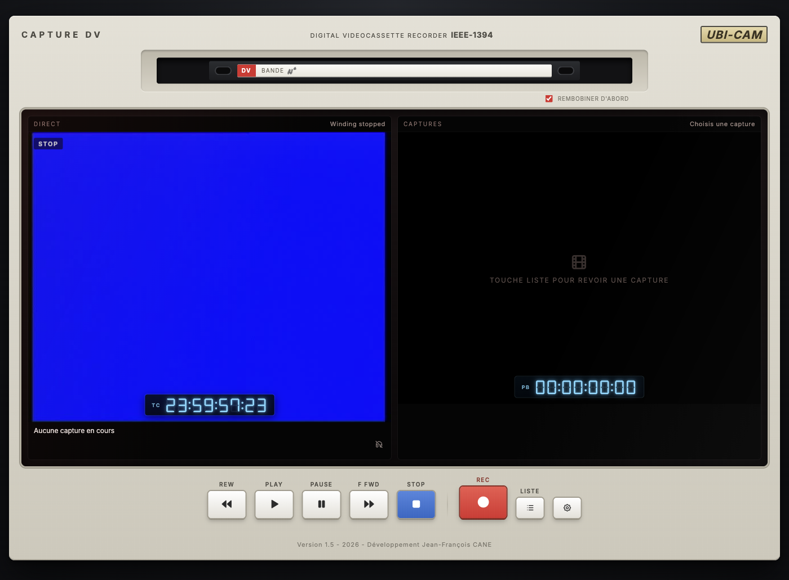

# UbiCam (UBI-CAM) — capture des bandes DV / DVCAM

Interface web qui pilote les caméras et magnétoscopes DV en FireWire. Elle capture chaque bande dans un fichier .dv par jour de prise de vue, puis fabrique les .mov lisibles sur ordinateur.

## En images

**La façade** : l'écran DIRECT montre ce que lit la platine, avec son timecode ; l'écran CAPTURES rejoue les vidéos déjà faites. Les touches pilotent la bande en FireWire (AV/C), REC lance la capture.



**Des images issues de bandes capturées** (DVCAM, 2001 et 2002), lues dans les .mov fabriqués par UbiCam :


## Installation actuelle

- Conteneur sur Proxmox.
- Interface : http://192.168.xxx.xxx:8080
- Captures : partage `//192.168.xxx.xxx/DV-CAM`, dossier `Captures-DV`. Le rangement les envoie vers `Captures-DV-MASTER` et `Captures-DV-MOV`.

## Contenu

| Chemin | Rôle |
|---|---|
| `app/app.py` | Serveur Flask : direct, capture, pilotage de la bande, conversion .mov, rangement, annonces UbiVox |
| `app/facade.html` | Façade de la platine (page d'accueil) |
| `app/platine.py` | Ouvre la connexion de sortie de la platine (oPCR), qui n'émet qu'à la demande |
| `systeme/dvweb.service` | Service systemd |
| `systeme/fstab.extrait` | Montage du partage DV-CAM |
| `systeme/reglages.json` | Réglages de l'appli (dossier de capture, rembobinage) |
| `systeme/*.exemple` | Modèles des fichiers secrets (identifiants NAS, jeton UbiVox) |
| `proxmox/lxc-100.conf` | Configuration actuelle du conteneur (pour mémoire) |
| `proxmox/creer_conteneur.sh` | Crée le conteneur sur l'hôte Proxmox et lance l'installation |
| `installer.sh` | Installe l'appli dans un Debian 12 neuf |
| `UbiCam.tar.gz` | Tout ce qui précède, en une archive |

## Recréer le conteneur

Sur l'hôte Proxmox :

```bash
tar xzf UbiCam.tar.gz && IP=192.168.xxx.xxx/24 PASSERELLE=192.168.xxx.xxx UbiCam/proxmox/creer_conteneur.sh 100 UbiCam.tar.gz
```

Remplacer avant tout les `192.168.xxx.xxx` par les adresses de votre réseau : l'IP du conteneur et la passerelle ci-dessus, l'adresse du NAS dans `systeme/fstab.extrait` et celle d'UbiVox dans `systeme/ubivox.env.exemple`.

Compléter ensuite `/etc/dvgrab-web/nas.cred` dans le conteneur, en droits 600. Redémarrer ensuite `dvweb`.

## Mettre à jour l'appli seulement

```bash
pct push 100 app/app.py /opt/dvgrab-web/app.py && pct exec 100 -- systemctl restart dvweb
```

`facade.html` est relue à chaque visite : on peut la remplacer sans redémarrer.

Ne jamais redémarrer `dvweb` pendant une capture ou une fabrication de .mov : `/etat` doit répondre `"actif":false`, sans message « Fabrication ».

## Points connus

- Le canal FireWire de la platine peut changer après un reset du bus (cassette remise, platine rallumée). dvgrab suit le canal réel et redémarre à chaque reconnexion.
- La fin de bande est reconnue même si la platine reste figée en lecture (60 s sans image ni mouvement du compteur).
- Le rembobinage passe par la commande AV/C WIND (bobinage rapide, environ ×80), pas par la lecture arrière.
- Bande sans date de prise de vue (Bande_117, montage sans date caméscope) : une date tapée en tête du nom (« 1996-06-30 - … ») sert aux images non datées, sinon la date du jour. Une vraie date lue plus loin la remplace.
- Les .mov passent par un flux corrigé (octet stype remis à SD) : un passage abîmé ne divise plus le nombre d'images.

## Soutenir le projet

UbiCam est libre et gratuit. Si l'appli vous a permis de sauver vos bandes DV, vous pouvez participer aux frais par PayPal :

**[Faire une contribution PayPal](https://paypal.me/lcnetwork)**

À quoi sert la contribution : acheter le matériel qui permet de tester UbiCam avec d'autres lecteurs (caméscopes, platines DV / DVCAM / Digital8) et les câbles FireWire qui vont avec. Chaque appareil a ses particularités sur le bus (sortie à ouvrir, commandes refusées, fin de bande mal signalée) : on ne peut les corriger qu'en ayant l'appareil sous la main.

Deux exemples de câbles IEEE 1394 (FireWire / i.LINK) utiles pour ces essais :

| Câble | Côté ordinateur | Côté lecteur | Exemple d'usage |
|---|---|---|---|
| IEEE 1394b 9 broches → IEEE 1394a 6 broches | FireWire 800 (adaptateur Apple Thunderbolt vers FireWire) | prise « i.DV IN/OUT » 6 broches | platine Sony DSR-1500AP |
| IEEE 1394b 9 broches → IEEE 1394a 4 broches | FireWire 800 (même adaptateur) | prise i.LINK / DV 4 broches | caméscope Sony DCR-TRV950E et la plupart des caméscopes DV |

La prise 4 broches ne transporte pas l'alimentation : le lecteur doit être branché sur secteur pendant la capture.
